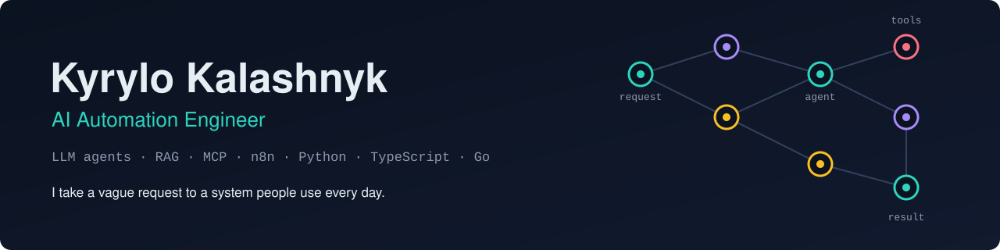
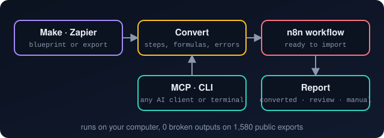
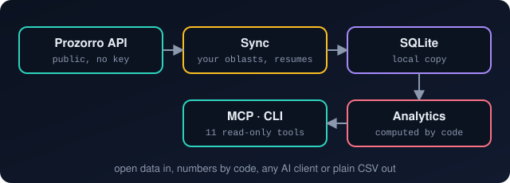
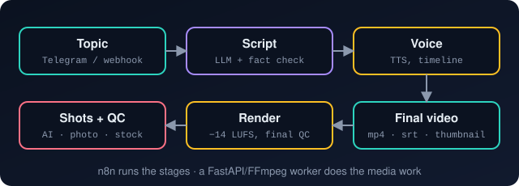
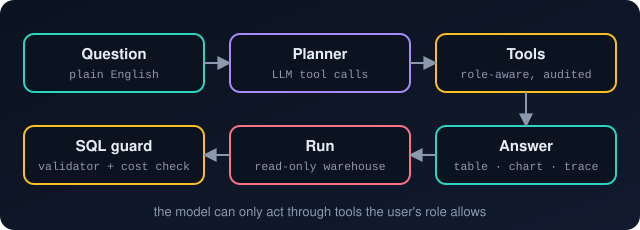
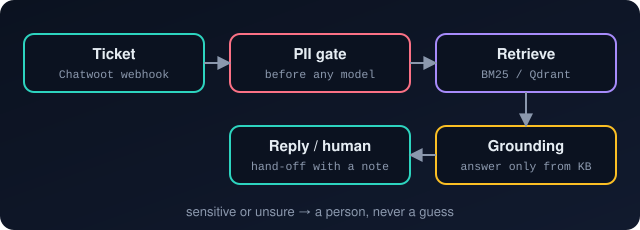
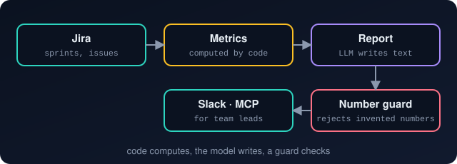
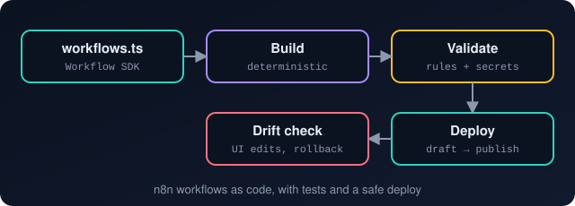
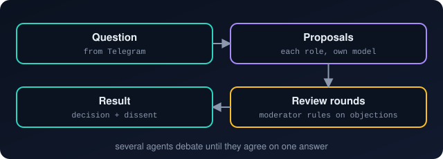
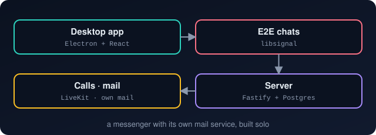

I build LLM agents and automations that people use every day, and take them from a vague request to
a system running in production. Most of my client work is private, so the repositories below are
**rebuilt reference versions** of systems I built for clients, plus my own open-source tools and products. Each one has
tests, CI and a README that says plainly what is verified and what is not.

### In client work

| | Result | How it is measured |
|---|---|---|
| 🎧 Support AI agent | **~30% → ~70%** of tickets handled without an agent | ticket share before and after, client helpdesk |
| 📊 Jira sprint agents | used by **8 team leads** across **9 departments**, every sprint | in production |
| 🎬 AI video pipeline | **$4–6** of API cost per 4–8-minute documentary, **18** n8n workflows | measured on test runs |
| ⚙️ n8n at scale | **20+** workflows generated from code and deployed through the API | in production |

## Projects

<table>
<tr>
<td width="50%" valign="top">

### [migrate-to-n8n](https://github.com/kotiniiqq/migrate-to-n8n)
Move Make scenarios and Zapier zaps to n8n: an importable workflow plus a report on every step.

**Stack:** TypeScript · Node.js · MCP · n8n

- every step ends up converted, to review (one named thing to check) or manual (left in place, disabled, with a note on how to finish it)
- routers, filters, iterators, formulas and error handlers carry over; nothing is dropped
- works from Claude, Cursor, VS Code or the terminal; scenarios never leave your computer

**Result:** 1,432 public Make scenarios and 148 zaps converted with 0 broken outputs; 83% of Make steps convert automatically or with one named check.

329 tests · imports and live webhook runs checked on real n8n 2.x and 1.x · my own open-source tool

</td>
<td width="50%" valign="top">

### [prozorro-mcp](https://github.com/kotiniiqq/prozorro-mcp)
Ukraine's public procurement (Prozorro) for an AI assistant or the terminal: open tenders, upcoming plans, market, competitors, red flags.

**Stack:** Python · MCP · SQLite · Prozorro API

- syncs only your oblasts from the public API, newest tenders first, resumes after a break, no keys
- unit prices, win rates, single-bidder share: computed by code, never by the model
- red flags with evidence; evals: precision and recall 1.0 on 35 cases, totals reconciled with raw data

**Saves:** a bidder gets new tenders and next month's planned purchases every morning instead of browsing prozorro.gov.ua by hand.

228 tests · on PyPI and in the official MCP Registry · one-click desktop extension · CSV for Excel without AI · my own open-source tool

</td>
</tr>
<tr>
<td width="50%" valign="top">

### [ai-video-pipeline](https://github.com/kotiniiqq/ai-video-pipeline)
Topic in, finished documentary out: script with sources, voice-over, shots, mastered mp4 with subtitles and a thumbnail.

**Stack:** n8n · TypeScript · Python · FastAPI · FFmpeg · OpenCV · Postgres · Docker

- every shot is checked (black, frozen, wrong length, face drift); 3 tries, then a safe fallback
- picture and narration stay in sync; −14 LUFS like broadcast
- runs end to end **without API keys** in demo mode

**Saves:** a documentary like this takes **15–20 h** by hand *(est.: script 4 h, voice 1 h, footage 4–6 h, editing 6–8 h)*; here it is **~1 h of review**.

75 + 92 tests · e2e on a real n8n: topic → video in ~3 min

</td>
<td width="50%" valign="top">

### [ai-data-analyst](https://github.com/kotiniiqq/ai-data-analyst)
Ask a data warehouse in plain English; get a table, a chart and the trace of how the answer was found.

**Stack:** Go · Fiber · React · TypeScript · Postgres · BigQuery · OpenRouter

- the model acts only through tools the user's role allows; every call is audited
- every SQL query goes through a validator; expensive ones need a click to approve, with the price
- answers with numbers no tool returned are rejected

**Saves:** a manager gets an answer in seconds instead of waiting for an analyst.

97 Go + 12 web tests · 10/10 e2e · reference version of the AI analyst I built on the client's BigQuery platform

</td>
</tr>
<tr>
<td width="50%" valign="top">

### [support-agent](https://github.com/kotiniiqq/support-agent)
A support agent that answers only from its knowledge base and hands everything else to a person.

**Stack:** Python · RAG · BM25 / Qdrant · Chatwoot

- personal data is caught before any model sees the ticket
- billing, VIP and abuse go straight to a person; unsure → hand-off with a ready note
- measured on a golden set and an adversarial set, in CI, without keys

**Result:** 0 wrong answers on the golden set, 62/62 adversarial tickets handled.

130 tests · client system: ~30% → ~70% of tickets

</td>
<td width="50%" valign="top">

### [sprint-analytics](https://github.com/kotiniiqq/sprint-analytics)
Jira sprint metrics computed by code and written up by an LLM, as a CLI and an **MCP server**.

**Stack:** Python · MCP · Jira API · evals · Langfuse (optional)

- story points, cycle time, time in status: computed, never guessed by the model
- a guard rejects any number the model did not get from the code
- evals measure the guard: precision 1.0, recall 0.79 on 22 cases

**Saves:** team leads get the sprint report without collecting numbers by hand.

90 tests · client system: 8 team leads, 9 departments

</td>
</tr>
<tr>
<td width="50%" valign="top">

### [n8n-workflow-kit](https://github.com/kotiniiqq/n8n-workflow-kit)
n8n workflows as TypeScript: tested Code-node logic, deterministic builds, a deploy that cannot break production.

**Stack:** TypeScript · n8n Workflow SDK · esbuild · n8n API

- deploy saves a draft, then publishes; a UI edit stops the deploy instead of being overwritten
- rollback with a backup; dependency-ordered deploys
- verified end to end on a real n8n 2.40

**Saves:** no more hand-edited production workflows; one command deploys and checks all of them.

70 unit tests · 8/8 e2e checks

</td>
<td width="50%" valign="top">

### [agent-orchestrator](https://github.com/kotiniiqq/agent-orchestrator)
Several role-based agents, each on its own model, argue in rounds until they all accept one answer.

**Stack:** Python · OpenRouter · aiogram (Telegram)

- architect, critic and pragmatist answer on their own, then review one draft in rounds
- the moderator accepts or rejects every objection; open ones are reported as dissent
- one decision with reasons in Telegram; the full debate as a file

**Saves:** a second and third opinion on design decisions in minutes.

77 tests · my own tool; the original code was lost, rebuilt for publication

</td>
</tr>
<tr>
<td width="50%" valign="top">

### [bmf-messenger](https://github.com/kotiniiqq/bmf-messenger)
My own desktop messenger: end-to-end encrypted chats, voice and video calls, screen sharing, built-in mail.

**Stack:** TypeScript · Electron · React · Fastify · PostgreSQL · libsignal · LiveKit

- E2E encryption on the Signal protocol
- its own mail service; installers built in CI with auto-update
- beta with a small group of users

~28k lines · 363 tests · built solo

</td>
<td width="50%" valign="top">

### Stack

**AI:** LLM agents and tool use · RAG · MCP · evals and guardrails · OpenRouter, Claude and OpenAI APIs

**Automation:** n8n (workflows as code) · Make · Zapier · migrations to n8n · Slack and Jira apps · Telegram bots

**Engineering:** Python · TypeScript · Go · FastAPI · Fiber · React · PostgreSQL · SQLite · BigQuery · Redis

**Delivery:** Docker Compose · Linux VPS · Nginx / Caddy · GitHub Actions

</td>
</tr>
<tr>
<td colspan="2" valign="top">

### Contact

✉️ [kotiniiqq@gmail.com](mailto:kotiniiqq@gmail.com) · 💬 [Telegram @kotiniiqq](https://t.me/kotiniiqq) 
📍 Antalya, Turkey · remote · English B1

</td>
</tr>
</table>
